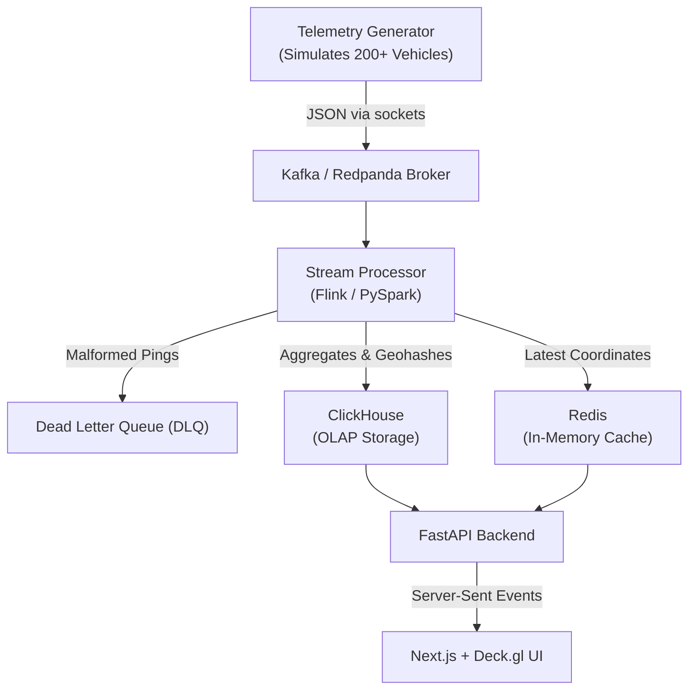

# 🏎️ Real-Time Geospatial Fleet Analytics Engine


An end-to-end, real-time data engineering pipeline demonstrating distributed stream processing, stateful windowing, and resilient architecture patterns (Dead Letter Queues). 

This project simulates a live fleet of delivery vehicles, processes their telemetry at high throughput, and serves sub-second spatial aggregations to a hardware-accelerated frontend.

## 🌟 Key Engineering Features

*   **Resilient Streaming (DLQ):** Intentionally injects malformed JSON and schema violations to demonstrate robust Dead Letter Queue routing without dropping the pipeline.
*   **Stateful Windowing:** Computes tumbling window aggregations (e.g., rolling speed averages) in real-time.
*   **Multi-Sink Architecture:** Routes "hot" state (current location) to Redis for $O(1)$ lookups, and "cold/analytical" state to ClickHouse for lightning-fast OLAP queries.
*   **Spatial Indexing:** Encodes raw latitude/longitude coordinates into H3 hexagonal grids on the fly for efficient geographic aggregations.

## 🏗️ Architecture



## 📂 Repository Structure

*   `docker-compose.yml`: Orchestrates every service (lives at the repository root).
*   `/infrastructure`: Initialization scripts for ClickHouse.
*   `/generator`: Python script to simulate fleet movement and inject chaotic/malformed data.
*   `/processor`: Stream processing application handling geohashing, windowing, and DLQ routing.
*   `/api`: FastAPI application serving SSE streams and aggregate REST endpoints.
*   `/ui`: Next.js frontend with Deck.gl for 60FPS map rendering.
*   `/tests`: Unit and API contract tests for the generator, processor and API (`pytest`).
*   `/docs`: Project documentation.
*   `/wikis`: Architecture notes and phase-by-phase acceptance criteria.

## 🧑‍💻 Local Development

```bash
python3 -m venv .venv
source .venv/bin/activate
pip install -r requirements-dev.txt

ruff check . && ruff format --check .
pytest
```

## 🚀 Quick Start

Ensure you have [Docker](https://docs.docker.com/get-docker/) and Docker Compose installed.

1. **Clone the repository:**
   ```bash
   git clone https://github.com/yourusername/realtime-fleet-analytics.git
   cd realtime-fleet-analytics
   ```

2. **Spin up the data platform:**
   ```bash
   cp .env.example .env   # then edit credentials / tuning knobs
   docker compose up -d
   ```
   *This single command boots the broker, databases, stream processor, data generator, and backend APIs.*

3. **Launch the UI:**
   ```bash
   cd ui
   npm install
   npm run dev
   ```

4. **View the Dashboard:**
   Navigate to `http://localhost:3000` to see the live map, telemetry metrics, and the DLQ monitor in action.

## 🧪 Chaos Engineering & DLQ

To see the Dead Letter Queue in action, adjust the chaos parameter in your `.env` (consumed by the `generator` service in `docker-compose.yml`):
```bash
CHAOS_PERCENTAGE=5  # Forces 5% of records to violate schema
```
Watch the "DLQ Monitor" on the frontend light up as bad payloads are safely quarantined without crashing the consumer.

## 🛠️ Built With

*   **Ingestion:** Python, Redpanda (Kafka compatible)
*   **Processing:** Apache Flink / Faust (Python)
*   **Storage:** ClickHouse, Redis
*   **Serving:** FastAPI (Python), Server-Sent Events (SSE)
*   **Frontend:** React (Next.js), Deck.gl, TailwindCSS