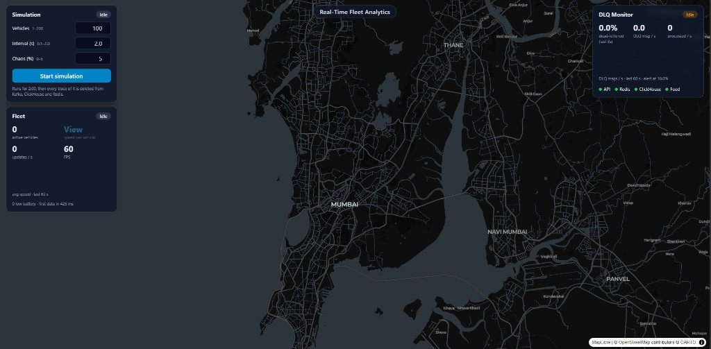
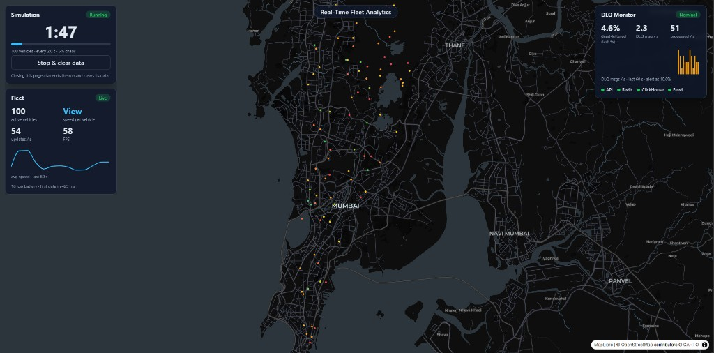
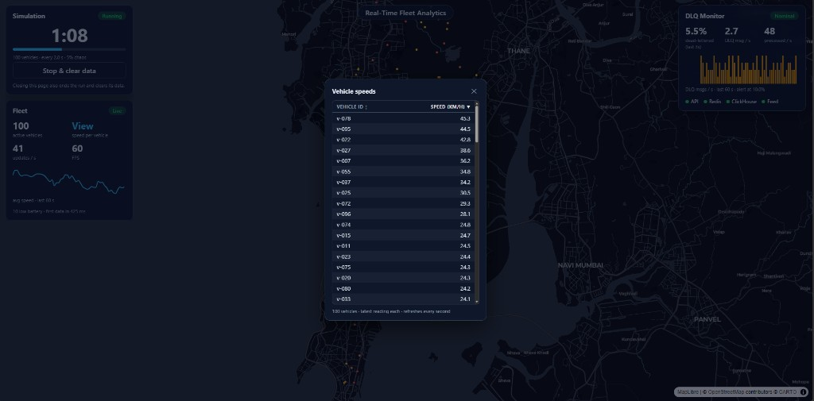
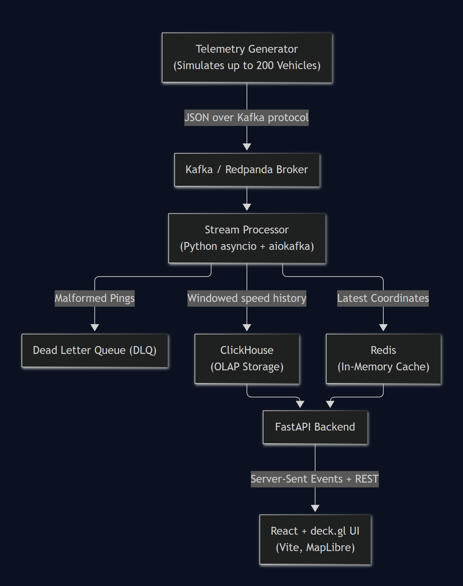

# 🏎️ Real-Time Geospatial Fleet Analytics Engine

An end-to-end streaming data pipeline. It simulates a fleet of delivery vehicles in Mumbai, processes their telemetry, and shows live positions on a map. It demonstrates stream processing, windowed aggregation, and dead-letter queues (DLQ).

## 🌟 Key Features

*   **Dead-letter queue:** malformed JSON and schema violations are routed to a DLQ without stopping the consumer.
*   **Windowed aggregation:** the processor computes the average speed per vehicle over 10-second tumbling windows.
*   **Two stores:** Redis holds each vehicle's latest position for fast lookups; ClickHouse holds the history and the speed rollups.
*   **Spatial indexing:** each position is stored with its H3 cell (resolution 9).

## 📸 Screenshots

The dashboard before a run:



A run in progress with the default settings (100 vehicles, 2.0 s interval, 5% chaos). The countdown, live fleet stats, and the DLQ monitor are on screen:



The **View** button in the Fleet panel opens every vehicle's latest speed, sorted by speed:



## 🏗️ Architecture



The image is a PNG export of the Mermaid source in [`wikis/images/architecture.mmd`](wikis/images/architecture.mmd). After editing the source, re-export the PNG with any Mermaid renderer, such as the Mermaid Live Editor.

## 📂 Repository Structure

*   `docker-compose.yml`: orchestrates every service.
*   `infrastructure/`: ClickHouse initialization SQL, run on first start.
*   `generator/`: simulates fleet movement and injects malformed data while a simulation runs.
*   `processor/`: consumes telemetry, indexes positions, runs the windows and DLQ routing, and clears a finished simulation.
*   `api/`: FastAPI service with SSE streams, REST endpoints, and simulation control.
*   `ui/`: React + Vite frontend, with deck.gl layers over a MapLibre base map.
*   `tests/`: pytest tests for the generator, processor and API. UI unit tests live in `ui/src` (Vitest).
*   `wikis/`: architecture notes (`architecture/design.md`) and the Docker Compose test guide.

## 🧑‍💻 Local Development

Python 3.10+ and Node 18.18+ are needed for these commands.

```bash
python3 -m venv .venv
source .venv/bin/activate
pip install -r requirements-dev.txt

ruff check . && ruff format --check .
pytest

# UI
cd ui
npm ci
npm run typecheck && npm test
```

## 🚀 Quick Start

Requires Docker with Compose v2.

1. **Clone the repository:**
   ```bash
   git clone https://github.com/Aarush-Kinhikar-0209/geospatial-telemetry-pipeline.git
   cd geospatial-telemetry-pipeline
   ```

2. **Create `.env` and start the stack:**
   ```bash
   cp .env.example .env   # set CLICKHOUSE_PASSWORD (and any tuning knobs)
   docker compose up -d --build
   ```
   This builds and starts the broker, databases, stream processor, generator, API and UI. Keep `.env` in LF line endings: Compose does not strip a trailing `\r` from values.

   Step-by-step checks are in [`wikis/test_guide_docker_compose.md`](wikis/test_guide_docker_compose.md).

3. **Open the dashboard:** go to `http://localhost:3000`. The stack starts idle. Choose a fleet size, interval and chaos rate in the **Simulation** panel, then press **Start simulation** (see [Simulations](#-simulations)). The API's Swagger UI is at `http://localhost:8000/docs`.

4. **(Optional) Run the UI with hot reload:**
   ```bash
   cd ui
   npm ci
   npm run dev   # http://localhost:5173, proxies /api to http://localhost:8000
   ```
   This needs Node on the host and the API from step 2 still running. Use it only when changing the UI; step 3 serves the built image.

### Is Docker Compose enough?

Yes. `docker compose up -d --build` runs everything the app needs, so Python and Node are not needed on the host for the stack. You need:

*   **Docker with Compose v2.** On Windows, use the Docker engine in WSL and run these commands from a WSL shell.
*   **A root `.env`** copied from `.env.example`. Compose refuses to start without `CLICKHOUSE_PASSWORD`.

Python (tests and linting) and Node (the Vite dev server) are needed only for the commands in Local Development and step 4.

Check that the stack is up:

```bash
docker compose ps
```

`api`, `redis`, `clickhouse`, `redpanda` and `ui` should show `(healthy)`. `generator` and `processor` have no health check, so they show only `Up`. The first build can take several minutes; later starts usually take under a minute.

### Ports and URLs

| Service | Address | Notes |
|---|---|---|
| **Dashboard** | http://localhost:3000 | The Docker stack's UI. Open this one. |
| API and Swagger | http://localhost:8000/docs | REST and SSE; health at `/api/v1/health` |
| ClickHouse | `localhost:8123` (HTTP), `localhost:9000` (native) | User and password from `.env` |
| Redis | `localhost:6379` | |
| Redpanda (Kafka) | `localhost:9092` | For tools on the host |
| Vite dev server | http://localhost:5173 | Only with `npm run dev` |

### Stop and clean up

```bash
docker compose stop      # pause: containers stop, data is kept
docker compose down      # remove containers and the network, data is kept
docker compose down -v   # also delete the data volumes (Redis, ClickHouse, Redpanda)
```

`down -v` deletes all stored telemetry and frees disk space. The built images are kept, so the next `up` starts quickly.

## ▶️ Simulations

Nothing is generated until a simulation starts. The **Simulation** panel takes:

| Setting | Range | Default |
|---|---|---|
| Vehicles | 1 – 200 (whole number) | 100 |
| Interval (s) | 0.1 – 2.0 | 2.0 |
| Chaos (%) | 0 – 5 (whole number) | 5 |

**Start simulation** runs the fleet for 2 minutes (`SIMULATION_DURATION_SECONDS`) with a countdown. The form and the API both reject out-of-range values (the API returns `422`). Only one simulation runs at a time; a second start returns `409`. **Stop & clear data** ends a run early.

**Movement.** Each ping moves a vehicle by its speed times the time since its last ping, multiplied by `MAP_DISTANCE_SCALE` (10 in `generator/main.py`). The scale is for presentation: it makes movement visible at city zoom, but the distance moved no longer matches the reported speed. At 10×, a vehicle in city traffic (5–25 km/h) moves about 1–14 m per ping at 0.1–0.2 s intervals and about 30–140 m at 2 s. Reported speed and battery drain use the true distance. Set `MAP_DISTANCE_SCALE = 1` for real-world spacing.

When a run ends, its telemetry is deleted before the next run can start:

| Store | What is cleared |
|---|---|
| Kafka (Redpanda) | all records in `telemetry_raw` and `telemetry_dlq` (the consumer group moves to the end) |
| ClickHouse | `telemetry_events` and `speed_rollups` are truncated |
| Redis | `vehicle:*` latest states and the per-second `metrics:pipeline:*` counters |

A run ends, and its telemetry is cleared, when:

* the timer reaches zero,
* you press **Stop & clear data**, or
* **the page goes away.** The page sends a heartbeat every 2 s during a run. If none arrives for `SIMULATION_HEARTBEAT_TIMEOUT_SECONDS` (10 s), for example because the tab was closed or the browser crashed, the API ends the run and clears it. Reloading the page does not end the run; the countdown resumes.

**How it works.** The API owns the run lifecycle (`running → stopping → cleaning → idle`) and stores it in Redis under `simulation:state`. The generator produces while a run is active and acknowledges once it has flushed. The processor then discards its windows, clears the three stores, and acknowledges. Its clearing runs on the same consumer loop, so nothing it buffered can be written after the wipe. The state lives in Redis, so restarting a service resumes the lifecycle. Endpoints: `GET /api/v1/simulation` and `POST /api/v1/simulation/{start,stop,heartbeat}`.

## 🗺️ Base Map

The map uses the keyless [CARTO Dark Matter](https://github.com/CartoDB/basemap-styles) style by default.

To use another provider, set `VITE_MAP_STYLE_URL` to any **MapLibre-compatible** style JSON. For example, with a [MapTiler](https://cloud.maptiler.com/account/keys/) key:

*   **Dev server:** put the line in `ui/.env.local` (gitignored; see `ui/.env.example`), then restart `npm run dev`:
    ```bash
    VITE_MAP_STYLE_URL=https://api.maptiler.com/maps/dataviz-dark/style.json?key=YOUR_MAPTILER_KEY
    ```
*   **Docker:** put the same line in the root `.env`, then rebuild the UI. Vite bakes `VITE_*` values in at build time:
    ```bash
    docker compose up -d --build ui
    ```

Mapbox `mapbox://` style URLs are not supported, because the UI renders with MapLibre GL. If the style fails to load, the UI shows a red "Base map" banner.

## 🧪 Chaos Engineering & DLQ

Each simulation's chaos rate (0–5%) sets the exact share of invalid payloads. At 5% the DLQ monitor stays in the green **Nominal** state. Bad payloads are quarantined without stopping the consumer.

The monitor turns red and shows **DLQ spike** when the dead-lettered share over the last 3 seconds reaches `VITE_DLQ_ALERT_RATIO` (default `0.1`, baked into the UI image at build time). The simulation form stops at 5%, so to force a spike, run a standalone generator configured from the environment:

```bash
docker compose run --rm -e CHAOS_PERCENTAGE=50 -e VEHICLE_COUNT=50 -e MESSAGE_INTERVAL=0.5 \
  generator python main.py --standalone   # Ctrl-C to stop
```

This traffic is not part of a simulation. The next simulation's cleanup clears it, or you can run `docker compose down -v`.

## 🛠️ Built With

*   **Ingestion:** Python, Redpanda (Kafka compatible)
*   **Processing:** Python asyncio, aiokafka, H3
*   **Storage:** ClickHouse, Redis
*   **Serving:** FastAPI (Python), Server-Sent Events (SSE)
*   **Frontend:** React 18, Vite, deck.gl, MapLibre GL (react-map-gl), Recharts
