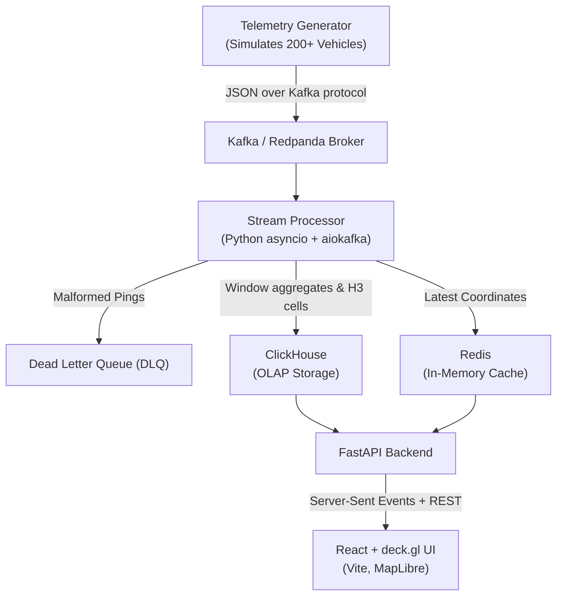

# 🏎️ Real-Time Geospatial Fleet Analytics Engine


An end-to-end, real-time data engineering pipeline demonstrating distributed stream processing, stateful windowing, and resilient architecture patterns (Dead Letter Queues). 

This project simulates a live fleet of delivery vehicles, processes their telemetry at high throughput, and serves live positions plus fast H3 zone aggregates to a hardware-accelerated frontend.

## 🌟 Key Engineering Features

*   **Resilient Streaming (DLQ):** Intentionally injects malformed JSON and schema violations to demonstrate robust Dead Letter Queue routing without dropping the pipeline.
*   **Stateful Windowing:** Computes tumbling window aggregations (e.g., rolling speed averages) in real-time.
*   **Multi-Sink Architecture:** Routes "hot" state (current location) to Redis for $O(1)$ lookups, and "cold/analytical" state to ClickHouse for lightning-fast OLAP queries.
*   **Spatial Indexing:** Encodes raw latitude/longitude coordinates into H3 hexagonal grids on the fly for efficient geographic aggregations.

## 🏗️ Architecture



## 📂 Repository Structure

*   `docker-compose.yml`: Orchestrates every service (lives at the repository root).
*   `/infrastructure`: Initialization scripts for ClickHouse.
*   `/generator`: Python script to simulate fleet movement and inject chaotic/malformed data.
*   `/processor`: Stream processing application handling H3 indexing, windowing, and DLQ routing.
*   `/api`: FastAPI application serving SSE streams and aggregate REST endpoints.
*   `/ui`: React + Vite frontend with deck.gl (WebGL) layers over a MapLibre base map.
*   `/tests`: Unit and API contract tests for the generator, processor and API (`pytest`). UI unit tests live in `ui/src` (`vitest`).
*   `/docs`: Reserved for longer write-ups (currently empty).
*   `/wikis`: Architecture notes, phase briefs, and the Docker Compose test guide.

## 🧑‍💻 Local Development

```bash
python3 -m venv .venv
source .venv/bin/activate
pip install -r requirements-dev.txt

ruff check . && ruff format --check .
pytest

# UI (Node 18.18+)
cd ui
npm ci
npm run typecheck && npm test
```

## 🚀 Quick Start

Ensure you have [Docker](https://docs.docker.com/get-docker/) and Docker Compose installed.

1. **Clone the repository:**
   ```bash
   git clone https://github.com/Aarush-Kinhikar-0209/geospatial-telemetry-pipeline.git
   cd geospatial-telemetry-pipeline
   ```

2. **Spin up the data platform:**
   ```bash
   cp .env.example .env   # set CLICKHOUSE_PASSWORD (and any tuning knobs)
   docker compose up -d --build
   ```
   *This builds and starts the broker, databases, stream processor, data generator, backend API, and the UI. Keep `.env` in LF line endings; Compose does not strip a trailing `\r` from values.*

   Step-by-step checks are in [`wikis/test_guide_docker_compose.md`](wikis/test_guide_docker_compose.md).

3. **View the Dashboard:**
   Navigate to `http://localhost:3000` to see the live map, telemetry metrics, and the DLQ monitor in action. The API's Swagger UI is at `http://localhost:8000/docs`.

4. **(Optional) Run the UI with hot reload:**
   ```bash
   cd ui
   npm ci
   npm run dev   # http://localhost:5173, proxies /api to http://localhost:8000
   ```

## 🗺️ Base Map & API Keys

The map works out of the box with the keyless [CARTO Dark Matter](https://github.com/CartoDB/basemap-styles) style, so no key is required.

To use your own provider, point `VITE_MAP_STYLE_URL` at any **MapLibre-compatible** style JSON. For example, with a free [MapTiler](https://cloud.maptiler.com/account/keys/) key:

* **Dev server:** create `ui/.env.local` (gitignored; see `ui/.env.example`):
  ```bash
  VITE_MAP_STYLE_URL=https://api.maptiler.com/maps/dataviz-dark/style.json?key=YOUR_MAPTILER_KEY
  ```
  then restart `npm run dev`.
* **Docker:** put the same line in the root `.env` and rebuild the image (Vite bakes `VITE_*` values in at build time):
  ```bash
  docker compose up -d --build ui
  ```

**Mapbox:** the UI renders with MapLibre GL, which cannot resolve `mapbox://` style URLs. Either use a MapLibre-compatible provider as above, or switch `ui/src/components/FleetMap.tsx` from `react-map-gl/maplibre` to `react-map-gl/mapbox`, add the `mapbox-gl` package, and pass your token via `mapboxAccessToken` (read it from a `VITE_MAPBOX_TOKEN` variable in `ui/.env.local`).

If the style fails to load, the UI shows a red "Base map" banner; vehicles and zones still render on a dark background.

## 🧪 Chaos Engineering & DLQ

The generator marks an exact share of payloads as invalid. The default in `.env` is `CHAOS_PERCENTAGE=5`, which the DLQ monitor reports as about 5% and leaves in the green **Nominal** state. Bad payloads are quarantined without stopping the consumer.

The monitor turns red and flashes **DLQ spike** when the dead-lettered share over the last 3 seconds reaches `VITE_DLQ_ALERT_RATIO` (default `0.1`, baked into the UI image at build time). Force that without editing `.env`:
```bash
CHAOS_PERCENTAGE=50 docker compose up -d generator   # monitor turns red within ~2 s
docker compose up -d generator                       # back to the .env value
```

## 🛠️ Built With

*   **Ingestion:** Python, Redpanda (Kafka compatible)
*   **Processing:** Python asyncio, aiokafka, H3
*   **Storage:** ClickHouse, Redis
*   **Serving:** FastAPI (Python), Server-Sent Events (SSE)
*   **Frontend:** React 18, Vite, deck.gl, MapLibre GL (react-map-gl), Recharts