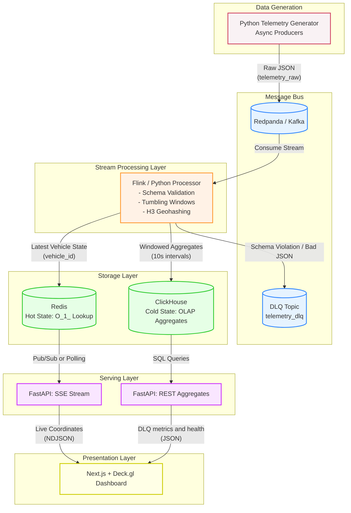

# 🏗️ System Architecture

This document outlines the architectural decisions, data flow, and component design for the Real-Time Geospatial Fleet Analytics Engine. 

The system is designed to handle high-throughput streaming data, process it with sub-second latency, and route bad records gracefully while serving both real-time operational state and historical analytical aggregates.

---

## 🌊 Data Flow Diagram



---

## 🧩 Component Breakdown

### 1. Ingestion: Synthetic Telemetry Generator
* **Role:** Simulates up to 200 vehicles driving on land inside Mumbai. It idles until a simulation is started (see [Simulation Lifecycle](#7-simulation-lifecycle)); the fleet size, message interval, and chaos rate come from that request.
* **Chaos Engineering:** Intentionally drops timestamps, malforms JSON, or corrupts schema types for 0-5% of events (a whole-number percentage chosen per simulation) to test pipeline resilience.
* **Protocol:** Produces messages to Redpanda via the Kafka wire protocol.

### 2. Message Broker: Redpanda
* **Role:** High-throughput, distributed log for decoupling ingestion from processing.
* **Why Redpanda?** It is API-compatible with Apache Kafka but written in C++, avoiding the JVM memory overhead. This makes it significantly lighter for local Docker-based development and CI/CD pipelines while maintaining production-grade performance.
* **Topics:** `telemetry_raw`, `telemetry_dlq`.

### 3. Stream Processing Layer
* **Role:** The core transformation engine. Validates incoming records against expected schemas.
* **Operations:**
  * **Validation:** Routes records failing schema checks strictly to the DLQ.
  * **Geospatial Indexing:** Converts `(lat, lon)` floats into H3 hexagon string IDs (resolution 9) and stores them on each telemetry event.
  * **Windowing:** Calculates rolling averages (e.g., speed, battery drop rate) using a 10-second tumbling window.

### 4. Storage Architecture (CQRS Pattern)
We use a polyglot persistence strategy to handle the differing read patterns of the UI:
* **Redis (Hot State):** Stores the absolute latest position and speed of every vehicle. The API requires $O(1)$ lookups to stream current locations. Storing this in an analytical database would result in expensive, unnecessary row updates.
* **ClickHouse (Cold/Analytical State):** An open-source columnar OLAP database. Used to store the windowed speed aggregates and historical telemetry paths.

### 5. Serving Layer: FastAPI
* **SSE (Server-Sent Events):** A unidirectional websocket alternative perfectly suited for streaming live telemetry to the browser without polling overhead.
* **REST Endpoints:** Standard JSON endpoints for the vehicle snapshot, the DLQ error rate, and dependency health.

### 6. Presentation: Next.js + Deck.gl
* **Deck.gl:** A WebGL-powered framework developed by Uber. It renders the moving fleet (`ScatterplotLayer`) on the GPU, far outperforming DOM-based mapping libraries (like Leaflet) for a live stream.

### 7. Simulation Lifecycle
A simulation is a timed run (2 minutes by default) whose data never outlives it. The API owns the lifecycle and stores it in Redis (`simulation:state`); the generator and processor follow it:

```text
idle --start--> running --(time up | stop | no heartbeat)--> stopping --> cleaning --> idle
                   generator produces      generator flushes + acks   processor clears + acks
```

* **running:** the UI sends a heartbeat every 2 s. If none arrives within 10 s (tab closed, browser killed, connection lost) the API ends the run, so abandoned data is never left behind. A reload does not end a run.
* **stopping:** the generator stops producing, flushes its Kafka producer, and writes `simulation:generator_ack`. If it does not answer in 10 s the API proceeds anyway.
* **cleaning:** the processor, on its own consumer loop, drops its in-memory windows and buffered rows, deletes every record in `telemetry_raw` and `telemetry_dlq` (`DeleteRecords` up to each partition's end offset, then moves its consumer group there), truncates `telemetry_events` and `speed_rollups`, deletes `vehicle:*` and `metrics:pipeline:*` from Redis, and writes `simulation:processor_ack`. It refuses to acknowledge a purge that left records behind.
* **idle:** the API removes `simulation:state`; the next run may start. Starting while a run is active is rejected (`409`).

Every transition is level-triggered (each component acts on what it reads, not on an event it may have missed), and state lives in Redis, so a restart of any service resumes the lifecycle. The generator also enforces the run's deadline itself, so a lost API cannot leave it producing indefinitely.

---

## ⚖️ Design Decisions & Trade-offs

1. **Why not just query ClickHouse directly for live map updates?**
   While ClickHouse is incredibly fast, it is optimized for append-only analytical queries. Frequently updating individual rows (e.g., vehicle locations updating every second) causes heavy background merges (Mutation overhead). Using Redis for mutable state isolates this load.

2. **Why H3 over raw Geofencing?**
   Calculating spatial joins (e.g., "Is coordinate X inside polygon Y?") mathematically on the fly is computationally expensive. Uber's H3 grid system converts coordinates into a deterministic string index. This turns expensive geospatial queries into simple, extremely fast string aggregations (`GROUP BY h3_index`).

3. **Dead Letter Queue (DLQ) Strategy**
   In streaming environments, a bad payload can cause infinite retry loops, crashing consumers and stalling partitions (poison pill). By catching serialization/schema exceptions and routing the raw bytes to a DLQ, the pipeline continues processing valid data while preserving the corrupted data for engineering review.